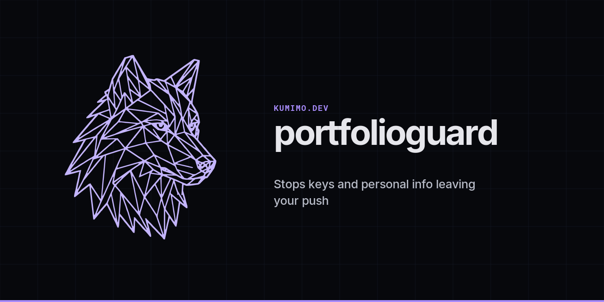

# PortfolioGuard

**Version: 0.3.1**: Includes context fixes for SVG and LinkedIn phone false positives, plus exact public email value allows. History mode can require expected commit author and committer identities, alongside the 0.3.0 Action, MyKad, Slack, Discord and Stripe rules.

Offline Python helper that looks through a Git repo for things that look like secrets or personal data before you push. It runs on your machine only (no network) and prints the file, line and rule name. It never prints the matched text itself. Handy as a second look, but a clean run is **not** a guarantee that nothing sensitive is in there.

## Requirements

Python 3.11+ and Git.

## Run a scan

Point it at the repo you care about:
```sh
python /path/to/PortfolioGuard/portfolioguard.py .            # working tree
python /path/to/PortfolioGuard/portfolioguard.py . --staged    # staged contents
python /path/to/PortfolioGuard/portfolioguard.py . --history   # reachable Git history
python /path/to/PortfolioGuard/portfolioguard.py . --range BASE..HEAD # commits in a range
```

Working tree mode covers tracked and untracked files that Git isn't ignoring. Staged mode looks at what's in the index. History mode walks every reachable commit. Fine on small repos, can be slow on big ones.

In `--history` mode you can require that every reachable commit uses an expected author and committer identity. Set `[[expected_identities]]` in `portfolioguard.toml` with an `email` and optional `name`, or pass `--expect-email EMAIL` (repeatable). The CLI list merges with the config list. When that list is set, any commit whose author email or committer email is outside it is reported as `unexpected-commit-identity`. The finding shows the short commit hash in the source, plus `author:` or `committer:` and the email in the path. Leave it unset and history mode stays content only, same as before.

By default it skips directories named `.git`, `node_modules`, `dist`, `build`, `.venv`, `venv`, `__pycache__`, `.idea` and `.vscode` in every mode. It also skips binary files (null byte near the start) and anything over 1 MB. Change the size with `--max-bytes BYTES` (e.g. `--max-bytes 2000000`). That applies to working tree, staged, history, range and pre-push. You can set the same limits in `portfolioguard.toml` (see below).

Exit codes: `0` means nothing outside the allowlist turned up, `1` means something needs a look, `2` means the scan or install couldn't run. Files mode adds `3`, meaning nothing needed a look but at least one file or stdin you named was not scanned (see below).

## Scan files outside a git repo

For loose files that aren't in a repository (drafts, notes, a folder you are about to upload), use files mode. It never runs Git, so it works anywhere:
```sh
python /path/to/PortfolioGuard/portfolioguard.py --files drafts/post.md         # one file
python /path/to/PortfolioGuard/portfolioguard.py --files drafts/ notes/todo.md  # directories and files
cat drafts/post.md | python /path/to/PortfolioGuard/portfolioguard.py --stdin  # standard input
python /path/to/PortfolioGuard/portfolioguard.py --files notes.md -             # a file plus stdin
```

1. `--files PATH...` takes files and directories. `--stdin` (or a lone `-` in the path list) reads text from standard input and also turns files mode on. `--stdin-name NAME` sets the name shown for stdin findings (default `<stdin>`). Newlines and other control characters in names are shown as `?`, so a name can't fake an output line. On a terminal, `--stdin` waits for you to finish typing and says so on stderr.
2. Directories are searched recursively in a stable sorted order. Symlinks found inside a directory are ignored, and so are FIFOs, sockets and devices, which are never opened because reading them can block forever. A symlink you name yourself is followed, whether it points at a file or a directory. A file reached twice is scanned once. Sub directories with a skipped name (the same defaults and `skip_dirs` setting as above) are not entered. A directory you name yourself is still scanned, so `--files dist` works, but a `node_modules` inside it is not.
3. Findings use the same rules, output lines, `--format json`, `--candidates` and exit codes (`0`, `1`, `2`, plus the new `3` described below) as repo scans. Only the source label changes: `files` for paths and `stdin` for standard input, for example `files: drafts/post.md:12 [email_address]`.
4. The name shown is the path as you typed it, tidied (`./drafts/../drafts/post.md` becomes `drafts/post.md`), with `/` separators. For a directory it is the directory you gave plus the path inside it. Absolute paths stay absolute.
5. The size cap and binary skip work as in repo mode (`--max-bytes`, `max_file_bytes`). Files that look like UTF-16 (PowerShell redirection and Notepad can write it) contain null bytes, so they count as binary and are not scanned. Save such files as UTF-8 first.
6. A skip is never presented as clean. For a file or stdin you named yourself, a line such as `PortfolioGuard: skipped drafts/big.md (over size limit)` goes to stderr, stdout says `NOT SCANNED: 1 named input(s) were skipped (see stderr). A clean result does not cover them.` instead of `No configured patterns matched.`, and the exit code is `3`. Real findings still win, so a run with findings and a skipped input exits `1` and prints both. Code `3` is new and was picked because `0`, `1` and `2` are taken: it is non-zero, so a script or hook treats the run as not clean, but it is different from `1`, so it isn't confused with a finding. With `--format json` or `--candidates`, stdout stays machine readable and the notice goes to stderr. Files skipped inside a directory (binary, over the size cap, unreadable, or not a regular file) are counted in the summary, for example `Skipped 3 file(s) inside directories: 2 binary, 1 over size limit.`, and don't change the exit code. A path that doesn't exist is an error (exit `2`).
7. There is no repository root, so the current directory plays that part. `.portfolioguard-allowlist` and `portfolioguard.toml` are read from it (the usual fallback to the config next to `portfolioguard.py` still applies), or use `--allowlist PATH` and `--rules PATH`. An exact allowlist entry must match the name as printed, so use `drafts/post.md:12:email_address` when you pass `drafts/post.md`. Glob entries such as `drafts/*.md:email_address` match as before.
8. Files mode can't be combined with `--staged`, `--history`, `--range`, `--pre-push` or `--install-hook`. Without `--files` or `--stdin`, nothing changes: PortfolioGuard still needs a Git repository.

A clean run only means these patterns didn't match, so it's still a second look and not a guarantee.

## Warning: skipped paths are not “clean”

PortfolioGuard does **not** scan the default skipped folders, or files over the size cap. Those can still get committed and published. Things that catch people out:

1. GitHub Pages (or similar) serving `/docs`, `dist` or `build`, or build output sitting in the repo root
2. A secret that ended up under `node_modules`, `.venv` or another skipped tree
3. A big text dump over the size cap that never gets scanned

So a clean scan does **not** mean skipped or over size stuff is fine. A clean exit with a private local allowlist also does not mean a fresh clone or Pages publish is clean, because that allowlist is not present there. If you're about to publish a static site (or anything else) that lives under a skipped name, take it out of the skip list or bump the size cap first.

Put the overrides in that repo's `portfolioguard.toml` (same file that holds custom rules). `skip_dirs` **replaces** the built in list when you set it. `max_file_bytes` sets the size cap (`--max-bytes` on the command line wins if you pass it):
```toml
# Keep most defaults but scan dist/ and build/ before a Pages publish:
skip_dirs = [".git", "node_modules", ".venv", "venv", "__pycache__", ".idea", ".vscode"]
max_file_bytes = 2000000
```

Binary files (null byte in the first 8 KiB) still aren't scanned, even if you raise the size cap.

## Allowlist

If `.portfolioguard-allowlist` exists at the repo root, it gets loaded. Use `--allowlist PATH` for a different file. Blank lines and `#` comments are ignored. Entries look like:

1. Exact finding: `path:line:rule`, e.g. `src/example.txt:12:email_address`
2. Path glob plus rule: `path-pattern:rule`, e.g. `docs/*.md:email_address` (any line in matching paths)

Paths are relative to the repo root with `/` separators. Rule names are whatever PortfolioGuard prints. Have a look at findings yourself before allowlisting them. Allowlisted ones don't trip exit code 1. This repo ships an allowlist for the deliberately fake fixtures in `test_portfolioguard.py` so a scan of itself stays quiet.

`--candidates` prints candidate allowlist lines from the current scan (paths, lines and rules only, never the matched text):
```sh
python /path/to/PortfolioGuard/portfolioguard.py . --candidates
```

For intentional public contact addresses, set `allowed_email_values` in `portfolioguard.toml`. Values match complete email addresses without regard to case. For example, `hello@kumimo.dev` is the public contact address used in the sample config. Private addresses such as personal Gmail addresses remain findings unless they are explicitly listed. Avoid putting this setting or a path allowlist in a Pages served tree. A committed `.portfolioguard-allowlist` file is public at `/.portfolioguard-allowlist` when the repository root is served by GitHub Pages.

## GitHub Action

If a pre-push hook never runs (cloud agents with a custom `core.hooksPath`, or anyone who pushes from a machine without the hook installed), add the workflow that ships in `.github/workflows/portfolioguard.yml`. It runs on every push and pull request, checks out with `fetch-depth: 0`, sets up Python, runs the unit tests, then scans the working tree and reachable history. The job fails on findings. Permissions stay at `contents: read` and no secrets are used.

Copy that workflow into another repo, or point a reusable workflow at this file once you publish one. Keep `portfolioguard.py`, the tests, and `.portfolioguard-allowlist` available to the job (same repo, or check them out beside the workflow).

## Pre-push hook

From a Git repo:
```sh
python /path/to/PortfolioGuard/portfolioguard.py --install-hook
```

The hook reads Git's pre-push update lines and scans the commits you're about to push. For an existing remote ref it scans `remote_sha..local_sha`. For a brand new ref it scans commits reachable from the local tip that aren't already on remote tracking refs, or the full reachable history if that comes up empty. Stays offline. Blocks the push if anything outside the allowlist is left. Doesn't rely on the staging area (usually empty after a commit anyway). Won't overwrite an existing hook unless you pass `--force`, which backs the old one up next to it as `pre-push.portfolioguard.bak` (adds a number if that name's taken).

## JSON output

`--format json` gives you a JSON array with `source`, `path`, `line`, `rule` and `allowed`. Still no matched text.
```sh
python /path/to/PortfolioGuard/portfolioguard.py . --format json
```

## Custom rules and scan limits

`portfolioguard.toml` can hold extra `[[rules]]` with `name` and regex `pattern`, plus optional top-level `allowed_email_values` (list of exact email values), `skip_dirs` (list of directory name strings), `max_file_bytes` (integer), and `[[expected_identities]]` tables (`email`, optional `name`) for history identity checks. Loaded from the repo root if present, otherwise from next to `portfolioguard.py`. `--rules PATH` picks a different file instead. Built-in rules always stay on. Don't put real secrets or personal data in the config.

Built in rules cover private keys, AWS and GitHub credentials, OpenAI secret keys, Slack bot and app tokens plus Slack incoming webhooks, Discord bot tokens and webhook URLs, Stripe secret and restricted keys (live and test), Azure account keys and shared access signatures, common secret assignments (including quoted JSON keys and compound env names), emails, phone numbers, Singapore style NRIC/FIN, and Malaysian MyKad numbers (dashed or 12 digit, with a real date and JPN birthplace code). Azure protocol only docs don't match. NRIC/FIN needs a valid checksum and proper boundaries. MyKad matches without dashes stay quieter and want a nearby IC or MyKad style keyword on the line.

Hook install quotes the interpreter and script paths with `shlex.quote`, so spaces and quotes in the path are fine.

## Demo

Deliberately fake values:
```text
$ python portfolioguard.py .
working-tree: sample.txt:1 [generic_secret_assignment]
working-tree: sample.txt:2 [email_address]

Found 2 non-allowlisted issue(s) across 2 finding(s). Review locally before sharing.
$ echo $?
1
```

## Version history

See [CHANGELOG.md](CHANGELOG.md).
